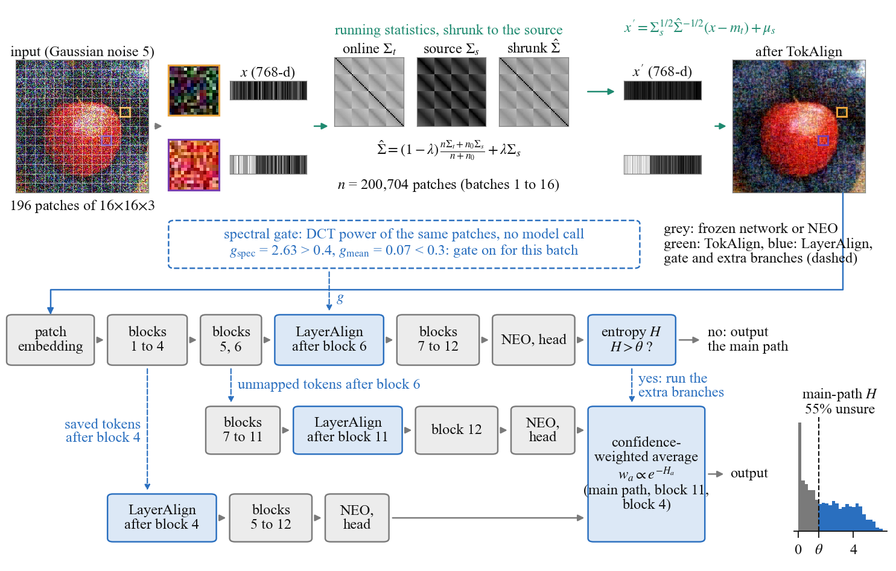

# Entropy Decides Where to Align: Gradient-Free Test-Time Adaptation of Frozen Vision Transformers

Code and data behind the report [Entropy Decides Where to Align](paper/report/report.pdf) (Jie Lin, University of British
Columbia, 2026; 4 pages plus supplement). Every number, table and figure in the report is generated from this repository.

<p align="center"></p>

A frozen vision transformer is corrected without labels or gradients by one closed-form whitening-and-recoloring map
(CORAL with a source prior), placed at the pixel patches (TokAlign) or after block *k* (LayerAlign), with NEO re-centering
the head input. The model's prediction entropy decides where to align: it picks the main block and two branch blocks from a
few hundred unlabeled target images, and at test time an image whose entropy exceeds a threshold also runs the two branches,
whose predictions are averaged with the main path. On held-out ImageNet-C the calibrated cascade adds +1.36 points to the
main path (+6.26 over NEO) at 1.49× NEO's time, and +1.20 on ImageNet-C-bar with blocks chosen on ImageNet-C alone.

## Installation

```
pip install -r requirements.txt
```

Python 3.12, PyTorch 2.9, `timm==0.4.12` (pinned: its default `vit_base_patch16_224` and `vit_small_patch16_224` weights are
the AugReg checkpoints used in the report; `deit_base_patch16_224` and `deit_small_patch16_224` are the DeiT checkpoints;
timm downloads them on first use). The FOA comparison needs a second environment with `timm==1.0.15` and `cma`, passed to
`reproduce_paper.sh` as `PY_TIMM1`. The official FOA and PEA code is not redistributed: fetch it at the pinned commits with
the commands in `third_party/foa/SOURCE.md` and `third_party/pea/SOURCE.md`. The official EATA/SAR code is in
`third_party/sar` (BSD 3-Clause, unmodified).

## Data

- ImageNet-1k validation set in class folders, `$IMAGENET_VAL/<wnid>/*.JPEG`.
- [ImageNet-C](https://github.com/hendrycks/robustness) as released, `$IMAGENET_C/<corruption>/<severity>/<wnid>/*.JPEG`.
- [ImageNet-C-bar](https://github.com/facebookresearch/augmentation-corruption): the authors' archive extracted, the
  `cbar_download` directory passed as `$IMAGENET_C_BAR`.
- [ImageNet-R](https://github.com/hendrycks/imagenet-r) and [ImageNet-Sketch](https://github.com/HaohanWang/ImageNet-Sketch)
  as class folders, `$IMAGENET_R` and `$IMAGENET_SKETCH`.

The splits (dev, source, four held-out sets of 2,000 images per cell, the 2,000-image cells of ImageNet-R and Sketch) are
fixed permutations with seed 20261019 in `tokalign/data.py`. `--cache-dir cache` stores each decoded cell as `.npy`.

## Usage

Nothing is trained. The source statistics (a minute on one GPU), the dev sweep that the calibration reads, the calibration
itself (CPU, no labels) and the held-out test, for ViT-B/16 on ImageNet-C:

```
D="--imagenet-val $IMAGENET_VAL --imagenet-c $IMAGENET_C --cache-dir cache --out-dir runs"
python scripts/compute_source_stats.py --model vitb --blocks --imagenet-val $IMAGENET_VAL --out stats/vitb_blocks.pt
python scripts/episodic/run_forward_only.py --split design --arms neo tok headcov tok+headcov place_b6 tok+place_b6 tok+place_b6+headcov --stats stats/vitb_blocks.pt --tag _two_site $D
python scripts/episodic/run_forward_only.py --split design --arms tok+place_b1 tok+place_b2 tok+place_b3 tok+place_b4 tok+place_b5 tok+place_b7 tok+place_b8 tok+place_b9 tok+place_b10 tok+place_b11 tok+place_b12 --stats stats/vitb_blocks.pt --tag _select $D
# headcov arms: a covariance map at the head input, an earlier stage the report uses only for the source-image sensitivity (Section H)
python scripts/analysis/site_choice.py --logits runs/logits --base forward_only_design_vitb_two_site --blocks forward_only_design_vitb_select --imagenet-val $IMAGENET_VAL --cells inc --out results/scores/site_choice_design_vitb.json
python scripts/episodic/run_forward_only.py --split heldout4 --arms rule_t6_b4b11_gated --stats stats/vitb_blocks.pt --tag _rule $D
python scripts/episodic/score_forward_only.py --runs runs/forward_only_heldout4_vitb_rule.json --imagenet-val $IMAGENET_VAL --neo-from results/scores/forward_only_heldout4_vitb_exit.json --out results/scores/forward_only_heldout4_vitb_rule.json
```

`site_choice.py` writes the main block (`trunk_pick_by_entropy`), the branch pair (`second_opinion_pick_pair`) and the
entropy quantiles under `label_free`. Arm names: `neo`, `tok` (TokAlign), `place_b<k>` (LayerAlign after block k),
`tok+place_b<k>` (the main path), `rule_t<b>_b<e>b<l>_gated` (the cascade: main block b, branches e and l, the paper's a1 and a2), `eta`, `sar`,
`tok+eta+place_b<k>` and `tok+eta+rule_t<b>_b<e>b<l>` (`run_gradient_host.py`). `--model vits|deitb|deits`,
`--dataset r|sketch` and `--cells clean <cells>` with `--imagenet-c $IMAGENET_C_BAR` select the other models and shifts.
Labels are read only by the `score_*.py` scripts.

**Every result in the report**, in run order (GPU steps S, E, T, C, F; CPU steps A, R; the report P):

```
export IMAGENET_VAL=... IMAGENET_C=... IMAGENET_C_BAR=... IMAGENET_R=... IMAGENET_SKETCH=... PY_TIMM1=/path/to/timm1-env/bin/python
bash reproduce_paper.sh
```

From the committed scores alone (CPU, seconds), the macros, figures and PDF are rebuilt with

```
python scripts/make_paper_numbers.py && python paper/make_numbers.py && python paper/make_figures.py && python scripts/analysis/number_inventory.py
cd paper/report && pdflatex report && bibtex report && pdflatex report && pdflatex report
```

`results/number_inventory.csv` lists every number printed in the report with its macro, score file and steps;
[`docs/results_provenance.md`](docs/results_provenance.md) does the same per table and figure. `pytest -q tests` (CPU)
checks the implementation and that the committed scores rebuild the numbers exactly.

## Results

Top-1 % on the fourth held-out set, ViT-B/16, blocks 6 / 4, 11 calibrated on unlabeled ImageNet-C dev images, θ = 1.5 nat
(report Table 1; time per batch relative to NEO):

| | ImageNet-C | ImageNet-C-bar | clean | unsure | time |
|---|---|---|---|---|---|
| NEO | 62.09 | 67.11 | 84.10 | 0% | 1.00 |
| + TokAlign | 64.11 | 67.95 | 84.10 | 0% | 1.03 |
| + LayerAlign after block 6 (the main path) | 66.99 | 69.03 | 84.10 | 0% | 1.04 |
| **+ branches 4, 11 on the unsure images (the calibrated cascade)** | **68.35** | **70.23** | 84.10 | 35% | 1.49 |

Gains over NEO on held-out cells, each model-shift pair calibrated anew on its own unlabeled dev images (report Table 3;
ETA columns include NEO):

| model | shift | pick | main path | cascade | ETA | ETA + main path | ETA + cascade |
|---|---|---|---|---|---|---|---|
| ViT-B/16 | ImageNet-C | 6 / 4, 11 | +4.88 | +6.17 | +1.95 | +5.96 | +6.94 |
| ViT-S/16 | ImageNet-C | 6 / 4, 11 | +6.95 | +8.62 | +5.08 | +9.12 | +10.25 |
| DeiT-B/16 | ImageNet-C | 6 / 7, 8 | +8.25 | +8.52 | +1.88 | +9.24 | +9.31 |
| ViT-B/16 | ImageNet-C-bar | 7 / 5, 11 | +2.50 | +3.29 | +1.79 | +3.52 | +4.42 |
| ViT-S/16 | ImageNet-C-bar | 7 / 6, 11 | +4.65 | +4.95 | +3.92 | +6.44 | +7.11 |
| DeiT-B/16 | ImageNet-C-bar | 6 / 7, 8 | +2.27 | +2.56 | −0.90 | +2.58 | +3.26 |
| ViT-B/16 | ImageNet-Sketch | 11 / 1, 7 | +0.48 | +0.62 | +1.22 | +1.38 | +1.40 |
| ViT-S/16 | ImageNet-Sketch | 6 / 8, 11 | −3.45 | −0.48 | +3.87 | −1.00 | +1.08 |
| DeiT-B/16 | ImageNet-Sketch | 7 / 5, 8 | +2.68 | +3.30 | +1.77 | +4.08 | +4.37 |

Ablations, controls, ImageNet-R, DeiT-S/16, the streams, the other methods and the bootstrap intervals are in the report.

## Layout

```
tokalign/        aligner.py (the maps at any placement and the cascade), runner.py (a stream of batches through a host),
                 stages.py, models.py, data.py, hosts.py (ETA, SAR)
scripts/         compute_source_stats.py, make_paper_numbers.py; episodic/ (run_*.py and score_*.py for the forward-only,
                 ETA, SAR, FOA and PEA runs), streams/, cost/, block_alignment/, analysis/ (site_choice.py: the calibration)
reproduce_paper.sh, results/ (scores/, paper_numbers.json, number_inventory.csv), paper/ (numbers.tex, make_*.py, figures/, report/)
tests/, docs/ (results_provenance.md, file_names.md, the held-out test plans with their outcomes, method_hier.md), third_party/
```

## Citation

```bibtex
@misc{lin2026entropy,
  title  = {Entropy Decides Where to Align: Gradient-Free Test-Time Adaptation of Frozen Vision Transformers},
  author = {Lin, Jie},
  year   = {2026},
  note   = {Course project, CPSC 532X, University of British Columbia}
}
```

MIT license (`LICENSE`); `third_party/sar` keeps its BSD 3-Clause license. Built on NEO (Murphy et al.), ETA and SAR (Niu et al.) and the
timm checkpoints.
